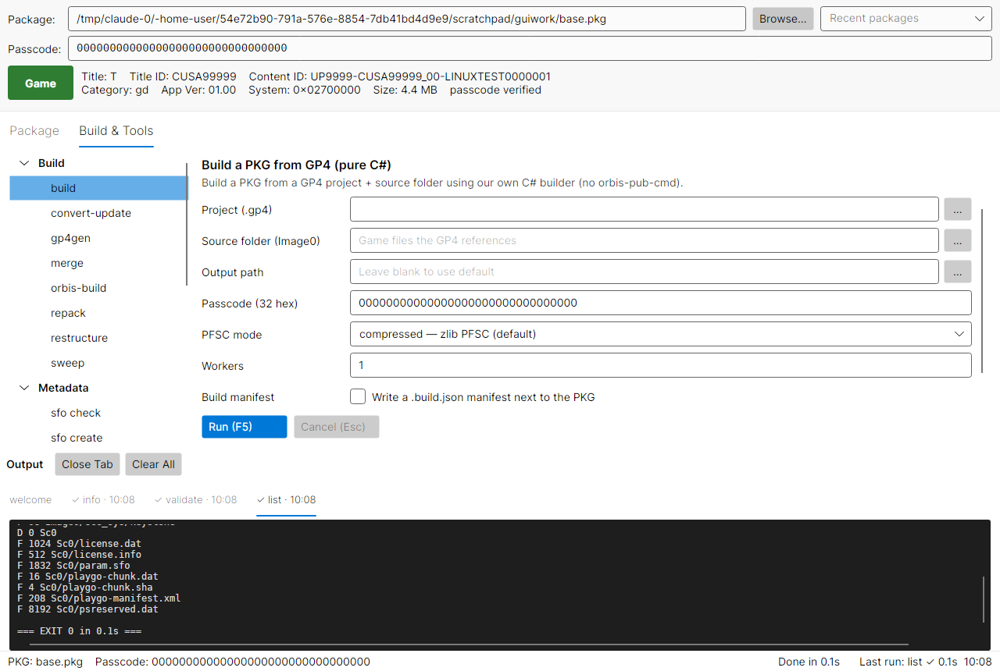

# OrbisPkgTool for Linux

Build, inspect, extract and check PS4 `.pkg` files **on Linux**, from the terminal or a desktop GUI.

This is a Linux port of [OrbisPkgTool](https://github.com/pearlxcore/OrbisPkgTool), which was Windows-only. The command-line tool and a new cross-platform GUI run natively on Linux (x64 and ARM64), with no Wine and no .NET install needed. Everything still builds and runs on Windows too.

> **Experimental:** packages generated by OrbisPkgTool have been validated and compared on PC, but they have not been tested on a jailbroken PS4. A successful build or validation does not guarantee that a package will install, launch, or play correctly on real hardware. Keep backups and use generated packages at your own risk.



## Install

1. Download the archive for your machine from the [latest release](https://github.com/Raid-Made/OrbisPkgTool/releases/latest):
   - `OrbisPkgTool-<version>-linux-x64.tar.gz`: most PCs and laptops
   - `OrbisPkgTool-<version>-linux-arm64.tar.gz`: ARM devices (Raspberry Pi 4/5 with a 64-bit OS, ARM laptops)
2. Extract it and run the installer:

   ```bash
   tar xzf OrbisPkgTool-*-linux-x64.tar.gz
   cd OrbisPkgTool-*-linux-x64
   ./install.sh
   ```

The installer puts the app in `~/.local/lib/orbispkgtool` and adds:

- `orbispkgtool`: the command-line tool
- `orbispkgtool-gui`: the GUI, also listed as **OrbisPkgTool** in your application menu

If `~/.local/bin` is not on your `PATH`, the installer tells you how to add it. Use `sudo ./install.sh --system` to install for all users under `/usr/local` instead. To remove it, run `./install.sh --uninstall` (add `--system` for a system install).

You can also run it without installing: `./OrbisPkgTool --help` and `./OrbisPkgTool.Gui.Avalonia` from the extracted folder.

The .NET runtime is bundled, so nothing else is required. The GUI needs a desktop session (X11, or Wayland through XWayland).

## Quick start

```bash
orbispkgtool --help                                # every command
orbispkgtool <command> --help                      # options and examples for one command

orbispkgtool info game.pkg                         # title, IDs, version, type
orbispkgtool validate game.pkg                     # deep 8-stage check
orbispkgtool extract game.pkg extracted            # unpack everything
orbispkgtool repack game.pkg --out rebuilt.pkg --validate
orbispkgtool merge base.pkg update.pkg --out merged.pkg --validate
```

The default fake-PKG passcode is `00000000000000000000000000000000`. Pass `--passcode <32 chars>` when a package uses a different one.

## Using the GUI

Start **OrbisPkgTool** from your application menu or run `orbispkgtool-gui`.

1. **Package bar** (top): choose a `.pkg` with **Browse…** or pick one from **Recent packages**. Its title, IDs, version, size and type badge (Game / Patch / DLC…) load straight away.
2. **Package tab**: operations on that package: inspect, validate, extract, diagnose.
3. **Build & Tools tab**: everything that doesn't start from one package: build from a GP4, gp4gen, repack, merge, convert-update, SFO and trophy tools, sweep.
4. Select an operation, fill in its options, and press **Run** (or **F5**). Each run gets its own output tab at the bottom with live progress and a ✓ or ✗ when it finishes. **Esc** cancels.

The GUI runs the same `orbispkgtool` command for every operation, and the output tab shows the exact command line it used, so anything you do in the GUI you can script in the terminal. Settings (last package, recents, window size) are saved in `~/.config/OrbisPkgTool/gui-settings.txt`.

## Commands

| Command | What it does |
| --- | --- |
| `info <pkg>` | Show title, title ID, content ID, version, category and package type |
| `list <pkg>` | List every file and folder in a package |
| `extract <pkg> <out-dir>` | Extract a package, or one file with `<pkg>:<path>` |
| `entries <pkg>` | Dump the raw PKG entry table |
| `validate <pkg>` | Deep 8-stage structural check (recommended) |
| `verify <pkg>` | Quick hash and signature check |
| `sweep <folder>` | Check every `.pkg` under a folder and write a TSV report |
| `gp4gen <folder>` | Generate a GP4 project from a folder of game files |
| `build <project.gp4> <folder>` | Build a package from a GP4 project |
| `repack <pkg>` | Extract and rebuild an app package in one step |
| `merge <base.pkg> <update.pkg>` | Merge a base game and its update into one package |
| `convert-update <update.pkg> --ekpfs <key>` | Experimental: turn a retail update into a fake patch |
| `ekpfs <pkg>` | Recover and print a fake package's EKPFS key |
| `restructure <dump>` | Tidy an extracted dump so it is ready for gp4gen/build |
| `sfo read\|create\|set\|check` | Read, create, edit and validate `param.sfo` files |
| `trp list\|extract\|create` | Work with trophy (`.trp`) archives |
| `orbis-build <project.gp4> <folder>` | Build through Sony's `orbis-pub-cmd.exe` (runs under Wine on Linux) |
| `inspect <pkg>` | Full PFS tree dump, for debugging |
| `bench <pkg>` | Measure listing speed |
| `selftest` | Check the built-in crypto keys |

### Inspect and extract

```bash
orbispkgtool info game.pkg
orbispkgtool list game.pkg
orbispkgtool extract game.pkg extracted
orbispkgtool extract game.pkg:Sc0/param.sfo extracted
orbispkgtool extract game.pkg:Image0/eboot.bin extracted
```

### Validate

```bash
orbispkgtool validate game.pkg
orbispkgtool validate --fake-tolerant scene_fpkg.pkg
orbispkgtool sweep ~/PKGs --out report.tsv          # every package in a folder
```

The validator checks the header, entry table, outer PFS, PFSC, inner PFS, digests, signatures, and filesystem walk. `--fake-tolerant` treats zeroed digests or signatures often found in scene FPKGs as warnings. Non-zero mismatches still fail.

### Build a package from a folder

```bash
orbispkgtool sfo create Image0/sce_sys/param.sfo --title "My Game" --title-id CUSA12345 \
    --content-id UP0000-CUSA12345_00-MYGAME0000000001     # only if the folder has no param.sfo
orbispkgtool gp4gen Image0 --out project.gp4
orbispkgtool build project.gp4 Image0 --out game.pkg --workers 0 --validate
```

Metadata is read from `sce_sys/param.sfo` when available. `--strict-gengp4` omits Sony-managed system targets so the file list matches `gengp4` more closely. For a patch, create the SFO with `--category gp` and run `gp4gen --patch`. The default PFSC mode is `compressed`; `--pfsc-mode store` disables compression. `--workers 0` uses every CPU core and gives byte-identical output.

### Repack

```bash
orbispkgtool repack original.pkg --out rebuilt.pkg --validate
```

Repacking extracts the package, restructures the dump, generates a GP4, and builds a new package. In compressed mode it carries the original's per-file compression choices into the new build. Use `--keep-work` to keep the intermediate files.

### Merge a base game and update

```bash
orbispkgtool merge "Game [CUSA00001] 00 - Base.pkg" "Game [CUSA00001] 01 - Update v01.09.pkg" \
    --out merged.pkg --validate
```

The base must be an app package and both packages must share a title ID. The update's files are laid over the base, and the result is one base-app package at the update's version, sealed with the default passcode. Options include `--base-passcode`, `--update-passcode`, `--pfsc-mode`, `--workers`, `--work-dir` and `--keep-work`.

### Convert a retail update (experimental)

```bash
orbispkgtool convert-update update.pkg --ekpfs <64-hex-key> --out fake_patch.pkg --validate
```

Decrypts a retail update with a supplied EKPFS key and rebuilds it as a fake patch, keeping the original `PARAM.SFO`, content type and flags. Base-package remarry is not implemented yet. `orbispkgtool ekpfs <pkg>` prints the EKPFS of a fake package.

### SFO and trophy files

```bash
orbispkgtool sfo read sce_sys/param.sfo
orbispkgtool sfo set sce_sys/param.sfo APP_VER 01.02
orbispkgtool sfo check sce_sys/param.sfo
orbispkgtool trp list trophy00.trp
orbispkgtool trp extract trophy00.trp trophies/
orbispkgtool trp create new.trp TROP.SFM ICON0.PNG
```

### PFSC compression profiles

```bash
orbispkgtool pfscprofile original.pkg --out pfsc_profile.json
orbispkgtool gp4gen Image0 --pfsc-profile pfsc_profile.json --out project.gp4
```

## Linux notes

- **Temporary space:** builds stage temporary files in `$TMPDIR` (default `/tmp`). If `/tmp` is small or RAM-backed (tmpfs), point it at a disk with room for large games: `TMPDIR=~/tmp orbispkgtool build …`. Large builds (over 2 GB) check the free space on the right disk before starting.
- **Compression:** the system zlib (`libz.so.1`) is used for PFSC compression, as on Windows. It is preinstalled on practically every distro (`zlib1g` / `zlib`); a built-in fallback is used if it is missing.
- **orbis-build:** needs Sony's Windows-only `orbis-pub-cmd.exe` with its `ext` folder, which is not included. On Linux it runs through Wine. It writes a generated `sce_sys/param.sfo` and `_orbis_build.gp4` into the game folder.

| Variable | Purpose |
| --- | --- |
| `TMPDIR` | Where builds stage temporary files |
| `ORBISPKG_ZLIB` | Path to a specific zlib library |
| `ORBIS_PUB_CMD` | Path to `orbis-pub-cmd.exe` for `orbis-build` |
| `ORBISPKG_WINE` | Wine binary for `orbis-build` (default: `wine` on `PATH`) |
| `ORBISPKGTOOL_CLI` | CLI the GUI should run (default: the one next to the GUI) |

## What this port changes

Compared with the original Windows tool:

- The CLI targets plain .NET 10 instead of Windows-only .NET, with Linux paths and help text.
- New cross-platform GUI (`OrbisPkgTool.Gui.Avalonia`) with the same layout and operations as the Windows Forms GUI. Both GUIs share one command list, which now also includes `ekpfs` and `convert-update`.
- Native zlib loads on Linux and macOS with the correct `z_stream` layout, so PFSC output uses the same 4 KiB deflate window as on Windows.
- Fixed a typo in a built-in RSA key that Windows tolerated but OpenSSL rejects, which broke entry-key decryption on Linux. `selftest` now checks the full key.
- The pre-build free-space check measures the actual mount point on Linux instead of always `/`.
- `sfo create --category gp` now writes a patch SFO; it used to write `gd`, so merges rejected the patch.
- `orbis-build` runs through Wine, and the developer commands print usage instead of crashing on missing arguments.
- Ready-to-run Linux releases (x64 and ARM64) with an installer.

## Build from source

Requires the [.NET 10 SDK](https://dotnet.microsoft.com/download).

```bash
dotnet build OrbisPkgTool/OrbisPkgTool.csproj -c Release
./OrbisPkgTool/bin/Release/net10.0/OrbisPkgTool --help

dotnet run --project OrbisPkgTool.Gui.Avalonia -c Release           # GUI
```

A self-contained folder like the release downloads (publish the GUI first, then the CLI into the same folder):

```bash
dotnet publish OrbisPkgTool.Gui.Avalonia -c Release -r linux-x64 --self-contained true -o out/OrbisPkgTool
dotnet publish OrbisPkgTool -c Release -r linux-x64 --self-contained true -o out/OrbisPkgTool
```

Releases are built by the **Release** GitHub Actions workflow: `gh workflow run release.yml -R Raid-Made/OrbisPkgTool -f version=1.2.0`.

```text
OrbisPkgTool/                 CLI and reusable package library
  PkgReader.cs                package listing and extraction
  PkgMergeService.cs          base and update merge pipeline
  Pkg/ Pfs/ Gp4/ Crypto/      builder, validator, PFS/PFSC, GP4, package crypto
  Sfo/ Trp/ Media/ Psn/       param.sfo, trophies, ATRAC9 decoder, PSN update check
OrbisPkgTool.Gui.Avalonia/    cross-platform GUI (Linux, Windows, macOS)
OrbisPkgTool.Gui/             Windows Forms GUI; CommandRegistry.cs is shared by both GUIs
packaging/linux/              installer and icon for the Linux release
```

## Windows

Everything still works on Windows: `dotnet build OrbisPkgTool.slnx` builds the CLI and both GUIs, and the Windows Forms GUI (`OrbisPkgTool.Gui`) is unchanged. On Windows, native `zlib1.dll` is optional and is found via `%ORBISPKG_ZLIB%`, the executable directory, common Git for Windows `mingw64` directories, then `PATH`. When starting the tool from another application, use `ProcessStartInfo` instead of passing the command through `cmd.exe`.

## C# API

```csharp
using OrbisPkgTool;
using OrbisPkgTool.Pkg;

using var pkg = new PkgReader("/home/me/games/game.pkg");

foreach (var file in pkg.ListFiles())
{
    Console.WriteLine($"{file.Size,12} {file.Path}");
}

pkg.ExtractFile("Sc0/changeinfo/changeinfo.xml", "extracted");
pkg.ExtractAll("extracted");

PkgBuilder.Build(
    "project.gp4",
    "Image0",
    "game.pkg",
    new BuildOptions
    {
        PfscMode = PfscMode.Compressed,
        Workers = 0,
        Validate = true
    });
```

The library also includes an ATRAC9 (`.at9`) to WAV decoder (`OrbisPkgTool.Media`) and a PSN update lookup (`OrbisPkgTool.Psn.UpdateCheck`); these have no CLI command yet. The merge pipeline is also available as `PkgMergeService`. Supply an `IProgress<PkgMergeProgress>` callback if your application needs step, file, byte, or validation progress.

## Compatibility notes

The reader and builder have been compared with packages produced by `orbis-pub-cmd 3.87`. Current testing covers PC-side structure, full extraction, single and multi-block files, doubly indirect files, GP4 file lists, PFSC compression policy replay, rebuilt package validation, and Unicode filenames.

Installation, launching, and gameplay on real PS4 hardware have not been tested yet.

Official retail PKGs are not the main target. For supported packages, the reader can recover `dk3` from `ENTRY_KEYS[3]` and decrypt key-index-3 `Sc0` entries such as `npbind.dat` and `license.dat` without the package passcode.

## Diagnostics

Low-level commands used while investigating package compatibility are still included:

```text
pfscprofile shadps4diag s4trace s4extract s4crypto pkgfields
signverify pfsdump pfsblock innerfpt iblock fixdigests resignpfs
xtstest buildtest emptypayload pfscompare dumppfsc dumpinner
xtsdump inflatecheck deftest blkcount
```

They are intended for format debugging rather than normal package work.

## Credits and license

Based on [OrbisPkgTool by pearlxcore](https://github.com/pearlxcore/OrbisPkgTool) (Windows). MIT. See [LICENSE](LICENSE).
